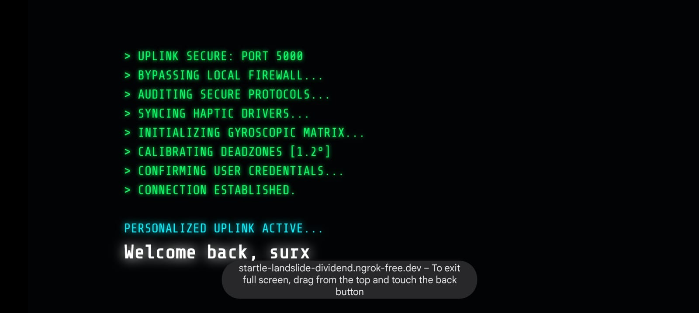
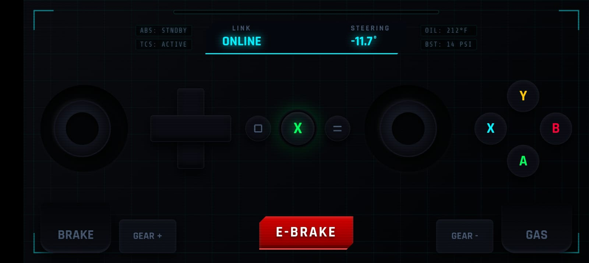

# 🏎️ EzController — Wireless Gyro Racing Wheel (Virtual Xbox 360 Controller)

Turn your phone into a wireless steering wheel, MotoGP handlebar, and Xbox 360 controller. No app to install — the client is a single web page, and the server creates a **real** virtual gamepad that racing games (Forza, Assetto Corsa, MotoGP, Ride, Need for Speed, DiRT, BeamNG, etc.) already understand.

Version 2 adds **native Linux support** via the kernel `uinput` API, a background `controller` command, an HTTPS tunnel helper, and a much faster input path. Windows is still supported through the original `vgamepad`/ViGEmBus backend.

---

## ✨ What's new in 2.0

* **Linux native** — no ViGEmBus, no Windows driver, no extra Python `evdev` package. It talks directly to `/dev/uinput`.
* **`controller` command** — starts the server in the background, prints the URL, and returns immediately. Includes `stop`, `restart`, `status`, `logs`, `doctor`, and `tunnel`.
* **Lower latency** — input changes are sent on the next display frame (`requestAnimationFrame`), WebSocket compression is off, Nagle is disabled, stale frames are not queued, and each frame is applied to the kernel as one batched write.
* **Crash-safe controls** — a 1-second watchdog releases the throttle/steering if the phone disconnects or the screen locks.
* **Game presets** — **Racing**, **MotoGP**, and **Cozy** layouts, each with its own labels, mappings, and saved steering tune. Racing is tuned for RaceRoom track work with a 12° lock, 1.4× steering expo, and analog pressure pedals. MotoGP adds a sharp bike profile plus gyro throttle/brake for automatic-gearbox play.
* **Steering tune panel** — invert, sensitivity, deadzone, steering expo, analog pedals, center calibration, and MotoGP tilt-throttle range/deadzone, saved on the phone.
* **Better touch handling** — multi-touch, touch cancellation, and a release-all on screen blur/visibility change.
* **HTTPS helper** — `controller tunnel install` downloads `cloudflared`, then `controller up` starts the server and a quick HTTPS tunnel. This is the reliable way to get gyroscope permission on mobile browsers.

---

## 🛠️ Prerequisites

### Linux

* A Linux PC with the `uinput` kernel module (standard on Debian, Ubuntu, Arch, Fedora, etc.).
* Python 3.10+.
* `websockets` 14 or newer.
* One-time `sudo` access for the `/dev/uinput` udev rule.

### Windows

* Python 3.10+.
* `websockets` 14 or newer and `vgamepad`.
* [ViGEmBus](https://github.com/nefarius/ViGEmBus/releases) installed.

### Phone

* A modern mobile browser (Safari or Chrome).
* Motion/gyroscope permission. **HTTPS is required by most mobile browsers for motion sensors** — see [HTTPS and the gyroscope](#-https-and-the-gyroscope).

---

## 📷 Images




---

## 🚀 Quick start — Linux

```bash
git clone https://github.com/devsurx/EzController.git
cd EzController

./install.sh          # installs the `controller` command (no root)
controller setup      # one-time: installs the uinput udev rule (asks for sudo)
controller            # start the server in the background
```

`controller setup` is only needed once. It:

1. Installs `/etc/udev/rules.d/99-ezcontroller.rules`.
2. Loads the `uinput` kernel module and persists it with
   `/etc/modules-load.d/ezcontroller.conf`.
3. Adds you to the `input` group if necessary.

If your user was just added to the group, log out and back in (or reboot) once.

Then open the printed **Phone** URL on your phone. Tap **SYS.IGNITION**, allow motion access, and hold the phone in landscape.

For gyro steering over HTTPS:

```bash
controller tunnel install   # downloads cloudflared to ~/.local/bin (no root)
controller up               # starts the server + tunnel, prints an https:// URL
```

> If `websockets` is missing or too old, `./install.sh` creates a private
> `.venv` in the checkout and the `controller` command uses it automatically.

### Manual start (no CLI)

```bash
python3 -m pip install --user -r requirements.txt
python3 server.py                 # Linux uinput backend
python3 server.py --pad mock      # test the protocol without a virtual pad
```

---

## 🪟 Quick start — Windows

```bat
git clone https://github.com/devsurx/EzController.git
cd EzController
pip install -r requirements-windows.txt
```

Install the ViGEmBus driver, then double-click **`racing.bat`** (or run `python server.py`). The original workflow is unchanged:

1. Start the server.
2. Start your tunnel (`ngrok http 5000`, or use `controller` from WSL/Git Bash if you prefer).
3. Open the HTTPS URL on your phone.
4. Tap **IGNITION**, allow motion, and drive.

The `controller` shell command is Linux-oriented, but the server itself is cross-platform.

---

## 🕹️ The `controller` command

```text
controller                start in the background (default)
controller up             start the server + HTTPS tunnel
controller stop           stop the server and tunnel
controller down           alias for stop
controller restart        restart (restores the tunnel if it was running)
controller status         PID, pad, URLs, client count, uptime, tunnel
controller url            print the current URLs
controller logs           last 60 log lines
controller logs -f        follow the log
controller logs 200       last 200 lines
controller tunnel         start an HTTPS tunnel (cloudflared or ngrok)
controller tunnel stop    stop the tunnel
controller tunnel status  show the HTTPS URL
controller tunnel install download cloudflared (no root)
controller setup          install the command + one-time uinput rule
controller doctor         check uinput, Python, port, module, tunnel
controller foreground     run in the foreground (Ctrl+C to stop)
controller version
```

Logs and PID files live in `${XDG_STATE_HOME:-~/.local/state}/ezcontroller/`.

### Environment variables

| Variable | Default | Meaning |
| --- | --- | --- |
| `EZC_PORT` | `5000` | HTTP/WebSocket port |
| `EZC_HOST` | `0.0.0.0` | Bind address |
| `EZC_PAD` | `auto` | `auto`, `linux`, `windows`, or `mock` |
| `EZC_PYTHON` | auto | Python interpreter to use |
| `EZC_HOME` | script location | EzController checkout |
| `EZC_SUDO` | `sudo` | Privilege command for `setup` (e.g. `sudo -A`) |

Examples:

```bash
EZC_PORT=5001 controller
EZC_PAD=mock controller foreground     # protocol test, no /dev/uinput
controller doctor
```

---

## ⚡ Why it feels instant (the "0 delay" path)

There is no artificial delay anywhere in the input path:

1. **Phone → browser:** touch and gyro events update in-memory state immediately. Normally sends are coalesced into the **next animation frame**; **MotoGP sends every motion sample immediately** so lean, throttle, and brake react without waiting for the frame. A 10 Hz heartbeat keeps held buttons alive when the gyro is still.
2. **Browser → server:** the WebSocket uses `TCP_NODELAY`; per-message compression is disabled; `max_queue=1` and `write_limit=0` prevent stale frames from piling up. Reconnects retry in 250 ms (backing off to 2 s).
3. **Server:** one JSON parse, one normalised state, and **one batched `write()`** to `/dev/uinput` per frame, ending in a single `SYN_REPORT`. Only changed axes/buttons are written.
4. **Kernel/game:** the virtual device advertises the exact Xbox 360 identity (`045e:028e`, "Microsoft X-Box 360 pad"), so SDL/Steam/Proton/native games use the standard xpad mapping. Sticks are ±32767, triggers are 0–255.
5. **No smoothing or interpolation.** The server never averages or ramps values.
6. **Watchdog:** if no valid frame arrives for 1 second (screen lock, Wi-Fi drop, browser crash), all controls are reset to neutral. On reconnect the new phone takes over and the old connection is closed.

The old 4.3-second boot animation is gone; the overlay now clears in about 0.3 s.

> "0 delay" means **no software-added delay**. Physical Wi-Fi, display refresh, browser scheduling, and an internet tunnel still have real latency. A 5 GHz LAN connection is the fastest option; Cloudflare/ngrok tunnels add internet round-trip time.

---

## 🎮 Controls

### MotoGP preset

Built for **automatic gearbox** bike racing. The shift buttons are removed and the brake/throttle surfaces are enlarged.

| Phone control | Xbox 360 | In MotoGP |
| --- | --- | --- |
| Rotate/tilt phone left-right | Left stick X | Lean / steer |
| Tilt phone forward | Right trigger (analog) | Gyro throttle |
| Pull/tilt phone back | Left trigger (analog) | Gyro front brake |
| **THROTTLE** (right trigger) | Right trigger | Manual throttle override |
| **FRONT BRAKE** (left trigger) | Left trigger | Manual front-brake override |
| **REAR BRAKE** (centre) / A | A | Rear brake |
| **B** | B | Tuck |
| **X / Y** | X / Y | Game actions |
| Right thumbstick | Right stick | Camera |
| D-pad / View / Menu / Guide | D-pad / Back / Start / Guide | Menus |

Gyro throttle and brake use the phone's **pitch** axis, which is independent of the left/right lean axis, so leaning does not add throttle. Use **TILT RANGE**, **TILT DEADZONE**, and **INVERT TILT** in **⚙ SETTINGS**. The triggers remain as analog overrides — whichever input is stronger wins.

The MotoGP tune is separate from the Racing tune: **12° lean to full lock**, **0.8° lean deadzone**, **20° tilt for full throttle/brake**, and **1.6° tilt deadzone** by default. These wider defaults keep small hand movements from slamming to full lock while remaining linear and latency-free. Its lean, throttle, and brake samples are sent immediately instead of waiting for the next animation frame.

### Racing preset

| Phone control | Xbox 360 |
| --- | --- |
| Rotate/tilt phone (landscape) | Left stick / steering |
| Right thumbstick | Right stick / camera |
| **GAS** (right trigger) | Right trigger, analog pressure |
| **BRAKE** (left trigger) | Left trigger, analog pressure |
| **GEAR + / GEAR −** | RB / LB |
| **A / B / X / Y** | Face buttons |
| **E-BRAKE** | B |
| D-pad | D-pad |
| View / Menu / Guide | Back / Start / Guide |

The Racing pedals are **analog**. Press near the top of **GAS** or **BRAKE** for a light application, slide your thumb lower for more pressure, and the fill shows the current value. The pressure is held until you lift, so you can feather the throttle out of a slow corner or trail-brake into an apex. Turn **ANALOG PEDALS** off in **⚙ SETTINGS** if you prefer simple on/off pedals.

### RaceRoom track setup

Bind the virtual pad once in RaceRoom under **Options → Controls → Controller**:

| RaceRoom action | Bind to |
| --- | --- |
| Steering | Left Stick X |
| Throttle | Right Trigger |
| Brake | Left Trigger |
| Shift up / Shift down | RB / LB |
| Handbrake | B |
| Look / camera | Right Stick |
| Menus | D-pad / View / Menu |

Start with **Steering Dead Zone 0%**, **Steering Sensitivity 50%**, **Speed Sensitive Steering 0%**, and **Steering Curve Exponent 1.0**. The phone already applies a 0.8° deadzone and a 1.4× expo, so leaving the game's curve linear avoids stacking two curves.

Then tune to taste:

* If the car feels **twitchy at speed**, raise in-game **Speed Sensitive Steering** to 25–50% or raise the phone's **SENSITIVITY** slightly.
* If the car feels **lazy or slow to turn in**, raise in-game **Steering Sensitivity** first, before lowering the phone's expo.
* If you want **finer corrections around straight-ahead** without changing full lock, raise **STEERING EXPO**.
* Use **CALIBRATE CENTER** on the grid while holding the phone in your normal driving position, not mid-corner.

Racing also uses a light adaptive filter: it removes hand tremor at rest but lets fast corrections through untouched, so countersteer is not delayed. MotoGP remains raw and immediate.

### Game presets

Tap **PRESET: …** (or **⚙ SETTINGS**) in the top-right HUD and choose a layout. The page remembers your last choice.

| Preset | Best for | Left stick | Triggers | Bumpers | Extra |
| --- | --- | --- | --- | --- | --- |
| **Racing** | RaceRoom, Forza, Assetto Corsa, DiRT, BeamNG | Gyro tilt steers, 1.4× expo | Analog gas / brake | Gear − / + | E-BRAKE, RPM HUD |
| **MotoGP** | MotoGP, Ride, SBK, automatic gearbox | Gyro lean (12° lock) | Gyro tilt throttle / brake + trigger overrides | Hidden | AUTO gearbox, rear brake, tilt tune |
| **Cozy** | Stardew Valley, 2D games | On-screen thumbstick, full X/Y | Switch item | Shift toolbar | No gyro, no e-brake |

Cozy uses the space freed by hiding the D-pad and Guide button to make the **left/right sticks, ABXY face buttons, triggers, and bumpers larger** — the controls you touch constantly in Stardew. The sticks also scale their throw with their on-screen size.

The Cozy **LT/RT item** and **LB/RB toolbar** buttons are flat, clicky buttons with no pedal travel or press animation. Short taps are held for a few frames on the trigger axes so the game cannot miss them between polls — tap once and the item switches immediately.

**Cozy** uses the standard Xbox 360 Stardew Valley mapping:

| Phone control | Xbox 360 | In Stardew Valley |
| --- | --- | --- |
| Left thumbstick | Left stick | Walk / run |
| Right thumbstick | Right stick | Move cursor, open chat |
| **A** | A | Do action / interact |
| **X** | X | Use tool |
| **Y** | Y | Crafting menu |
| **B** | B | Cancel / menu |
| **LT / RT** | LT / RT | Switch item |
| **LB / RB** | LB / RB | Shift toolbar |
| View / Menu / Guide | Back / Start / Guide | Journal / menu / guide |

### Steering tune panel

Tap **⚙ SETTINGS** in the top-right HUD. Racing and MotoGP each keep their own tune:

* **INVERT** — flip steering/lean direction if your phone is mounted the other way.
* **SENSITIVITY** — total tilt for full lock (Racing default 12°, MotoGP default 12°). Increase it if the car or bike still feels twitchy.
* **DEADZONE** — center deadzone (Racing default 0.8°, MotoGP default 0.8°).
* **STEERING EXPO** (Racing) — 1.00× is linear; the default 1.40× gives finer corrections around straight-ahead while keeping the same full lock.
* **ANALOG PEDALS** (Racing) — on by default. Touch high on GAS/BRAKE for light pressure, low for full pressure.
* **TILT RANGE** (MotoGP) — forward/back tilt for full throttle or brake (default 20°).
* **TILT DEADZONE** (MotoGP) — ignore small pitch changes (default 1.6°).
* **INVERT TILT** (MotoGP) — swap gyro throttle and brake if the phone is held the other way.
* **CALIBRATE CENTER** — set the current lean (and MotoGP pitch) as neutral.
* **RESET DEFAULTS**.

Settings are stored in `localStorage` on the phone (`ezc.settings` for Racing, `ezc.bike` for MotoGP).

---

## 🔐 HTTPS and the gyroscope

Mobile browsers restrict motion sensors to **secure contexts**. On plain `http://192.168.x.x:5000` the buttons may work but the gyroscope can be blocked (iOS Safari is strict; Chrome behavior varies by version).

Use the tunnel:

```bash
controller tunnel install   # one time, downloads cloudflared
controller up
```

`controller up` prints something like:

```text
https://random-words-1234.trycloudflare.com
```

Open that on the phone. Cloudflare quick tunnels need no account.

If `cloudflared` is unavailable, `controller tunnel` falls back to `ngrok` if it is installed and authenticated:

```bash
ngrok config add-authtoken <your-token>
controller tunnel
```

**Security:** the server has no authentication. Anyone with the URL can control the pad. Use it on a trusted network, don't expose port 5000 to the internet, and stop the tunnel when you're done (`controller tunnel stop`). The tunnel URL is random but public.

---

## 🩺 Troubleshooting

### `Permission denied: '/dev/uinput'` / "uinput is not writable"

Run the one-time setup:

```bash
controller setup
```

Then check:

```bash
controller doctor
ls -l /dev/uinput      # should be crw-rw---- root input
id -nG                 # should include "input"
```

If you were just added to the `input` group, log out and back in. You can also test immediately with `sudo chmod 660 /dev/uinput` (temporary until reboot).

### Server starts then exits immediately

```bash
controller logs
```

Common causes: missing `websockets` (run `./install.sh`), no uinput permission (`controller setup`), or port 5000 already in use (`controller stop`, or `EZC_PORT=5001 controller`).

### Port already in use

```bash
controller status
controller stop
# or
EZC_PORT=5001 controller
```

### Phone shows OFFLINE / keeps reconnecting

* Make sure the server is running: `controller status`.
* Phone and PC must be on the same network for the LAN URL.
* If using a tunnel, wait a few seconds for the URL to become active.
* Check the log: `controller logs -f`.

### Steering counter stays at 0.0°

Open **⚙ SETTINGS** and read the **GYRO** line — it tells you what is wrong:

| GYRO line | Fix |
| --- | --- |
| `OFF IN COZY PRESET` | Switch the preset to **🏎️ RACING** or **🏍️ MOTOGP**. Cozy uses the touch left stick and intentionally ignores the gyro. |
| `NEEDS HTTPS` / `BLOCKED` | Open the **https://** URL from `controller up`. Mobile browsers block motion sensors on plain `http://` LAN addresses. |
| `PERMISSION DENIED` | Allow Motion & Orientation Access for the browser, then reload and tap **SYS.IGNITION** again. On iOS: Settings → Safari → Motion & Orientation Access. |
| `NO EVENTS` | The browser is not delivering sensor data. Try Chrome/Safari over HTTPS, and make sure the phone is not in a low-power/battery-saver mode. |
| `LIVE · GRAVITY …` / `LIVE · THR … BRK …` | Sensors are working. Steering/lean auto-centers on the first sample; tap **CALIBRATE CENTER** while holding your normal driving position if it drifts. |
| `LIVE (FALLBACK) · β … γ …` / `FALLBACK · ALLOW MOTION FOR TILT THROTTLE` | Motion permission was denied, so the less stable orientation fallback is in use. Reload over HTTPS and allow **both** Motion & Orientation prompts. MotoGP cannot use gyro throttle/brake without motion access. |

Steering and MotoGP throttle/brake are derived from the **gravity vector**, not raw Euler angles. That avoids the ±90° gimbal-lock flip you get when holding the phone upright. Hold the phone upright in landscape and rotate it like a steering wheel. If left and right are reversed, tick **INVERT**. If MotoGP accelerates when you pull back, tick **INVERT TILT**.

Quick tunnel reminder:

```bash
controller up
# open the printed https://...trycloudflare.com URL on the phone
```

### Steering is inverted or off-center

Open **⚙ SETTINGS**:

* Tap **INVERT** if left/right are reversed.
* Hold the phone in your normal driving position and tap **CALIBRATE CENTER**.
* Lower **SENSITIVITY** for less twitchy steering; raise it for more.

### The game doesn't see the controller

* Start the server **before** launching the game.
* Check `controller status` — the pad line should say `Linux uinput Xbox 360 pad`.
* Verify the device exists: `ls /dev/input/by-id/ | grep -i xbox` or `cat /proc/bus/input/devices`.
* In Steam, enable **Xbox 360 Controller** support if needed.
* Some games only enumerate controllers at startup — restart the game.

### Gyro doesn't work but buttons do

That is the secure-context restriction. Use `controller up` and open the HTTPS URL. On iOS, also allow **Motion & Orientation Access** when prompted (Settings → Safari → Motion & Orientation Access).

### High latency

* Prefer 5 GHz Wi-Fi and keep the phone and PC on the same access point.
* Close other browser tabs/apps on the phone.
* Don't use a free tunnel if you can avoid it; LAN is faster. If you need gyro, the tunnel is the tradeoff.
* Check `controller status` — message count should be increasing.

---

## 📂 Project structure

```text
server.py                  HTTP + WebSocket server, hot input path
ezcontroller/
  pad.py                   Linux uinput + Windows vgamepad + mock backends
  protocol.py              JSON → normalised InputState
  __init__.py              version
controller                 Linux CLI (background daemon, tunnel, doctor)
install.sh                 non-root installer, optional .venv
99-ezcontroller.rules      udev rule for /dev/uinput
index.html                 phone UI (gyro, touch, presets, tune panel)
requirements.txt           Linux/server dependencies
requirements-windows.txt   Windows dependencies (adds vgamepad)
racing.bat                 original Windows launcher (still works)
test.html                  old connection test page (unused)
```

---

## 🧠 How it works

```text
Phone browser (gyro + touch)
        │  JSON frames, next animation frame
        ▼
WebSocket :5000  (no compression, TCP_NODELAY)
        │
server.py  →  InputState  →  one batched write per frame
        │
        ▼
/dev/uinput  →  "Microsoft X-Box 360 pad"
        │
        ▼
Linux input stack  →  SDL / Steam / Proton / native game
```

On Windows the last two steps are replaced by `vgamepad` → ViGEmBus → virtual Xbox 360 controller.

---

## 🙌 Credits

Original concept, UI, and Windows backend by [devsurx](https://github.com/devsurx). Linux uinput backend, background CLI, latency work, and HTTPS helper added in 2.0.
